# BankInsight XAI — Classification explicable pour le marketing bancaire

Projet Challenge 1, ENSI, Data Mining, filières II3-IA et II3-IF, 2026/2027. Enseignante : Rym Besrour. Cas 3 : prédire la souscription à un dépôt à terme et expliquer les décisions. Ce prototype universitaire ne constitue pas une politique de ciblage validée pour une banque.

**Dépôt GitHub des sources publiques : [AhmedZri/BankInsight-XAI](https://github.com/AhmedZri/BankInsight-XAI).** Les 15 captures sont présentées ci-dessous. **Application en ligne : [BankInsight XAI](https://bankinsight-xai.streamlit.app/), vérifiée dans Chrome le 29 octobre 2026.** FastAPI reste interne au serveur et est appelée en HTTP par l’interface. Le code, les modèles et les résultats scientifiques sont gelés.

Le cahier des charges officiel est le PDF pédagogique fourni dans `docs/` pour la remise privée, lu intégralement (4 pages). Il est exclu du dépôt Git, de l’archive de publication et de Docker, faute d’autorisation de publication. La [matrice de conformité](docs/conformite.md) décrit les fonctions et leurs preuves de vérification. Le dépôt GitHub et l’application Community Cloud sont publiés ; la recette distante des six modules a réussi.

## Installation reproductible sous Windows

Python **3.11**, connexion Internet pour installer les dépendances ; le cache UCI public inclus permet ensuite le fonctionnement sans téléchargement de données. Depuis une extraction du ZIP, ouvrir PowerShell dans `BankInsight-XAI` :

```powershell
py -3.11 -m venv .venv
.\.venv\Scripts\python.exe -m pip install -r requirements.txt
.\.venv\Scripts\python.exe scripts/run_local.py
```

Ouvrir **http://127.0.0.1:8501** ; documentation API **http://127.0.0.1:8000/api/docs**. L’activation du venv n’est pas nécessaire. Arrêter les deux processus avec Ctrl+C. Si les ports sont occupés :

```powershell
.\.venv\Scripts\python.exe scripts/run_local.py --api-port 8010 --ui-port 8510
```

Sous Linux : `python3.11 -m venv .venv`, puis `.venv/bin/python -m pip install -r requirements.txt` et `.venv/bin/python scripts/run_local.py`. `requirements.txt` fixe les dépendances directes testées ; `requirements-lock.txt` capture également les dépendances transitives de l’environnement Windows vérifié (le paquet Linux n’utilise pas obligatoirement ce gel Windows).

Pour lancer séparément les services dans deux terminaux PowerShell :

```powershell
.\.venv\Scripts\python.exe -m uvicorn src.api.main:app --host 127.0.0.1 --port 8000
```

```powershell
$env:BANKINSIGHT_API_URL='http://127.0.0.1:8000'
.\.venv\Scripts\python.exe -m streamlit run app.py
```

Les variables facultatives figurent dans `.env.example` ; aucun secret ni fichier `.env` n’est requis. La lecture automatique d’un `.env` n’est pas implémentée : définir les variables dans le terminal si nécessaire.

## Données et provenance

[UCI Bank Marketing, jeu 222](https://archive.ics.uci.edu/dataset/222/bank+marketing) : 45 211 lignes, 16 variables brutes et cible `y` ; 5 289 réponses `yes` (11,7 %). Attribution : **Moro, S., Rita, P. et Cortez, P. (2014). Bank Marketing [Dataset]. UCI Machine Learning Repository. DOI [10.24432/C5K306](https://doi.org/10.24432/C5K306)**. Licence des données : **CC BY 4.0**, distincte de la licence du code.

`src/data.py` utilise `fetch_ucirepo(id=222)`, vérifie dimensions et classes puis enregistre `data/uci_bank.csv` et son manifeste SHA256. Le cache est relu et son empreinte vérifiée à chaque chargement. `load_uci(refresh=True)` retente le réseau et se replie sur le cache vérifié en cas d’échec. Le SHA256 détecte une altération accidentelle ; il n’est pas une signature cryptographique de l’éditeur. Le cache public fourni provient du téléchargement officiel réalisé pendant la validation.

La cible positive est `yes` et la négative `no`. **`duration` est interdite dans toute sélection et retirée avant la modélisation**, y compris pour les CSV. Point de décision : juste avant l’appel planifié, lorsque jour, mois, canal et rang de campagne sont connus. Le [détail de l’audit](docs/methodologie.md) explique la disponibilité des autres variables et les limites temporelles. `pdays=-1` est conservé (aucun contact précédent), `unknown` reste une modalité lorsqu’elle est présente ; les valeurs réellement manquantes du jeu récupéré sont imputées.

Pour les CSV : choisir cible, classe positive puis variables explicatives. Cible strictement binaire, non manquante ; minimum 30 lignes et 6 exemples par classe, puis contrôle des effectifs après séparation. Les valeurs infinies des caractéristiques deviennent manquantes. Les noms nettoyés doivent être distincts. Le nombre minimum ne garantit pas une évaluation scientifiquement précise. Les CSV ne sont pas enregistrés dans le cache public ; leurs modèles locaux restent dans le registre, **hors ZIP sauf liste explicite des modèles UCI publics**.

## Six modules

1. **Données** : acquisition UCI ou CSV, aperçu, types, statistiques, manquants, proportions, histogrammes interactifs, corrélations et taux positif par groupe.
2. **Préparation** : variables, imputations médiane/moyenne et modalité majoritaire/constante, one-hot, standardisation facultative, graine et test de 10 à 40 %.
3. **Modélisation** : logistique, arbre, KNN, forêt et XGBoost, paramètres avancés fixes ou recherche aléatoire (1 à 9 candidats, 3 plis), durées et comparaison. Une valeur fixée dans l’interface n’est pas remplacée par la recherche.
4. **Évaluation** : ROC-AUC, Average Precision (résumé de PR-AUC, pas intégrale trapézoïdale), précision, rappel, F1, rapport de classification, matrices de confusion, courbes ROC/PR superposées et seuil interactif.
5. **Explainable AI** : importances natives sauf KNN, coefficients signés de la logistique, permutation, SHAP beeswarm et dépendance, client du test ou formulaire fictif, SHAP waterfall, LIME, synthèse française issue des contributions et audit exploratoire des groupes.
6. **API** : santé, modèles, prédiction, SHAP/LIME local et SHAP/permutation global ; Streamlit appelle réellement FastAPI pour les trois opérations d’inférence et d’explication.

## Captures de l’application

Les 15 captures fournies sont conservées dans `assets/figures/screenshots/`. Elles illustrent les six modules de l’application locale. La préparation montre le mode rapide ; les vues de comparaison et d’évaluation affichent l’expérience complète archivée. Les résultats scientifiques présentés dans ce README restent inchangés.

### 1. Données et exploration

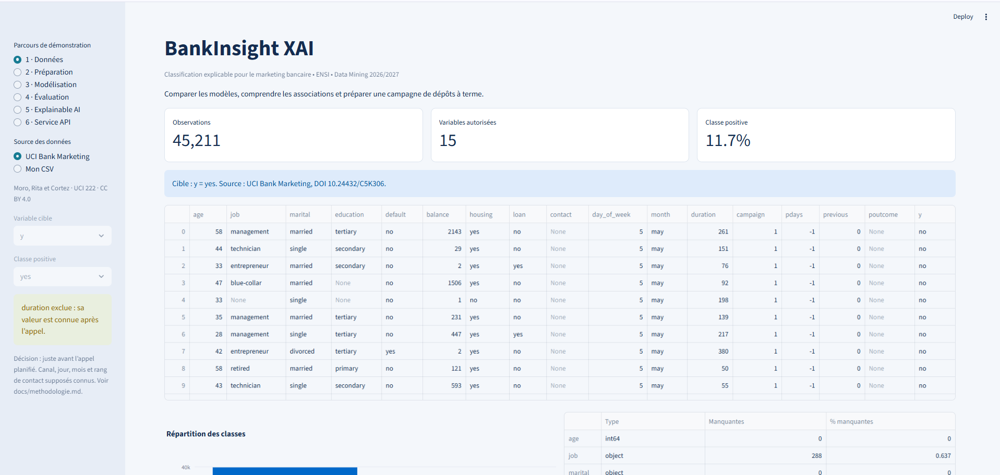

<details>
<summary>Répartition des classes, distributions et corrélations</summary>

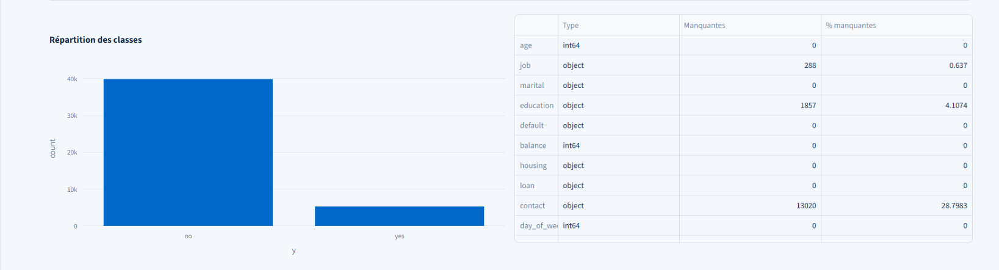

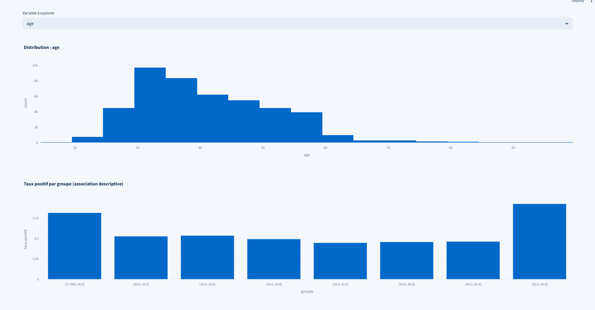

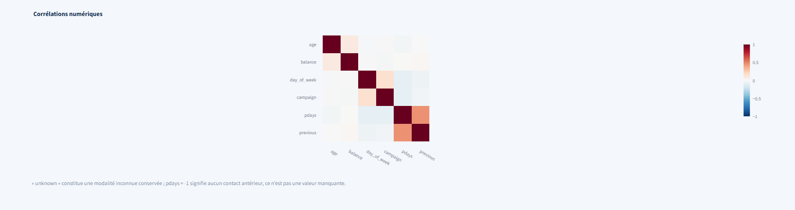

</details>

### 2. Préparation des données

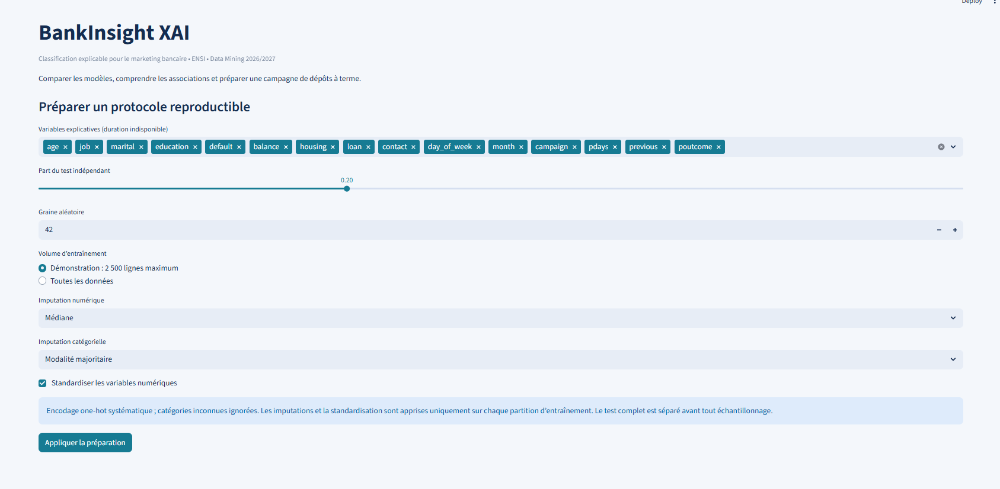

### 3. Modélisation et comparaison

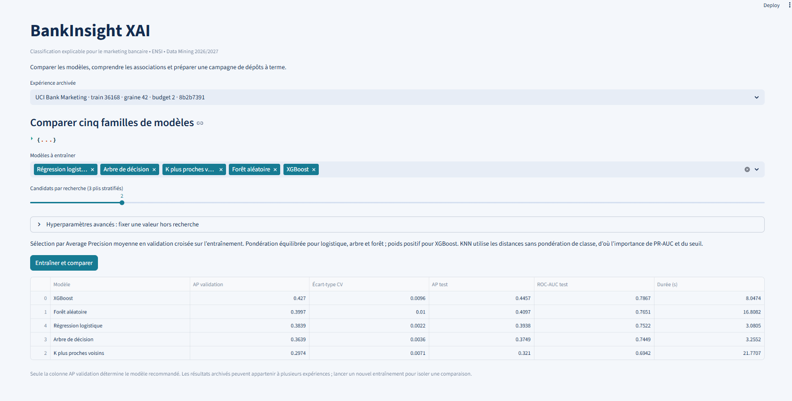

### 4. Évaluation

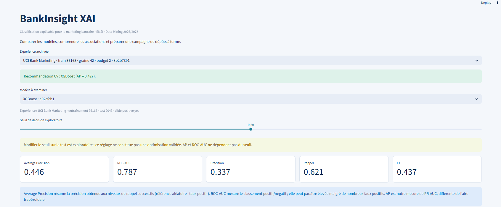

<details>
<summary>Courbes ROC, précision-rappel et matrice de confusion</summary>

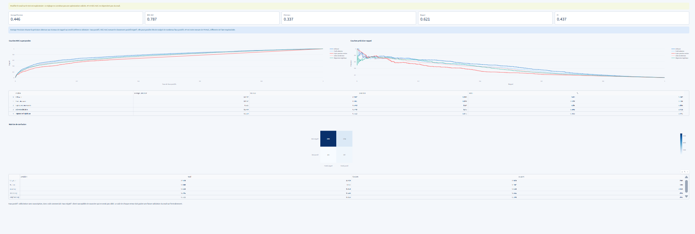

</details>

### 5. Explications SHAP et diagnostic LIME

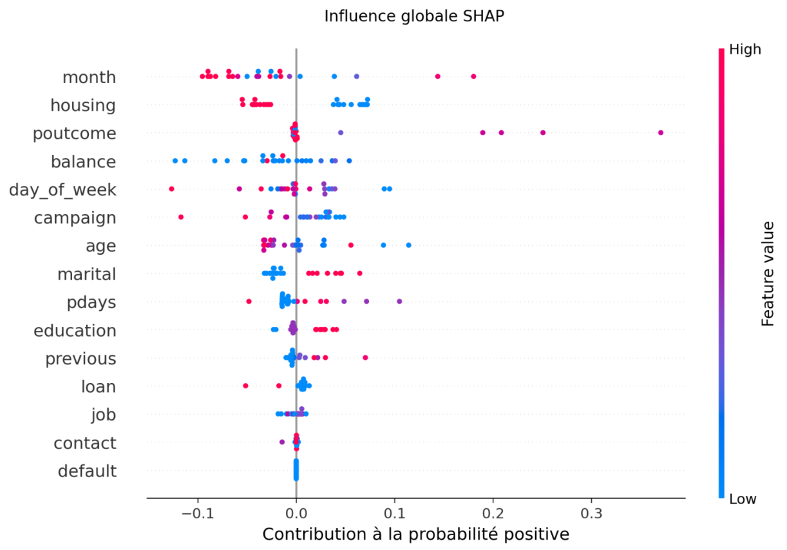

<details>
<summary>Dépendance SHAP, prédiction d’un client et explications locales</summary>

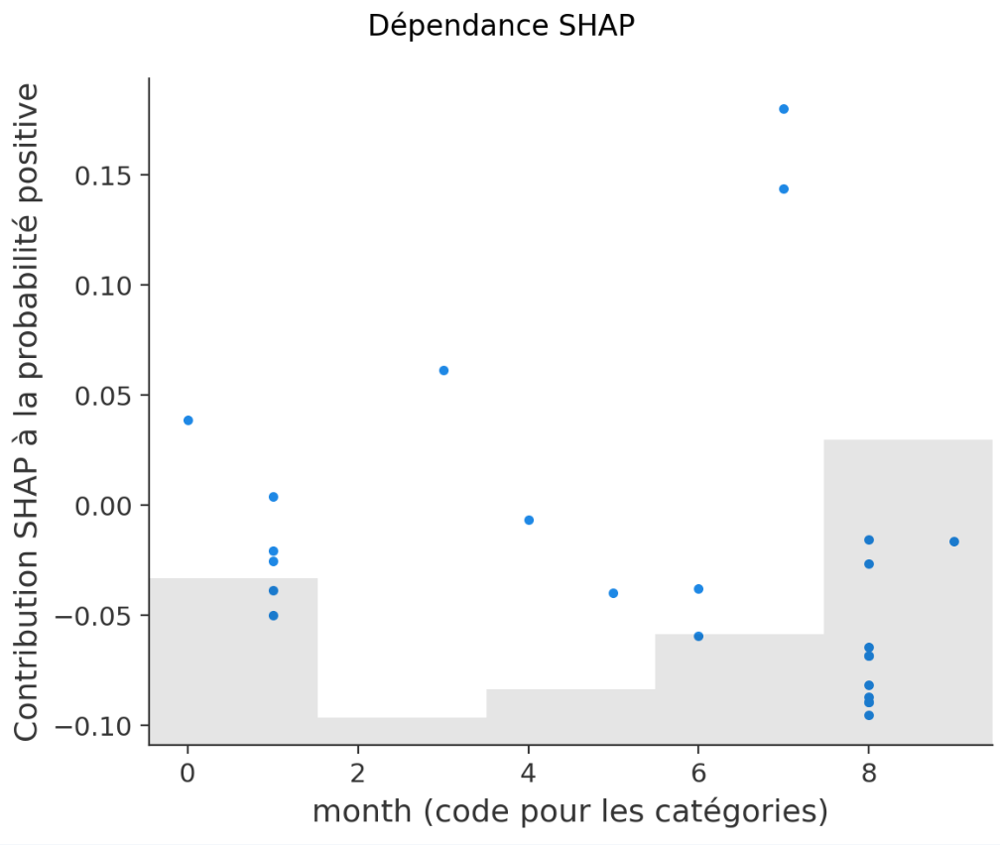

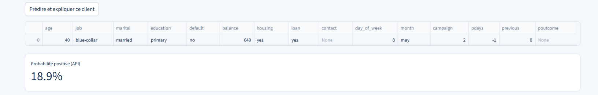

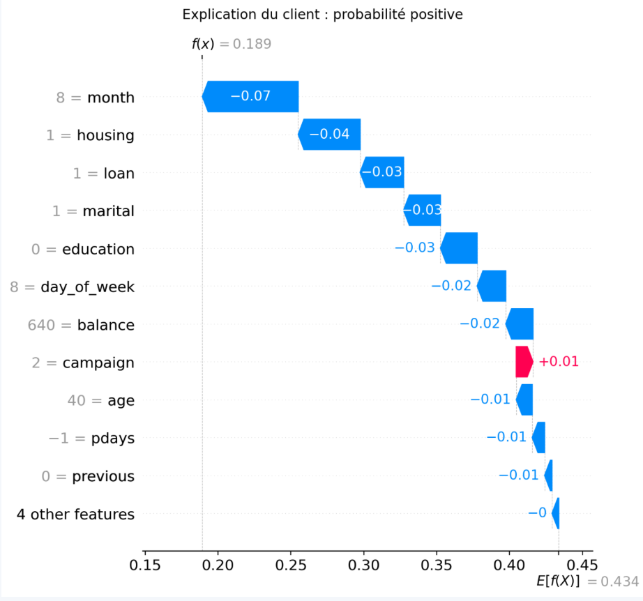

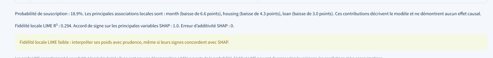

</details>

### 6. Service FastAPI

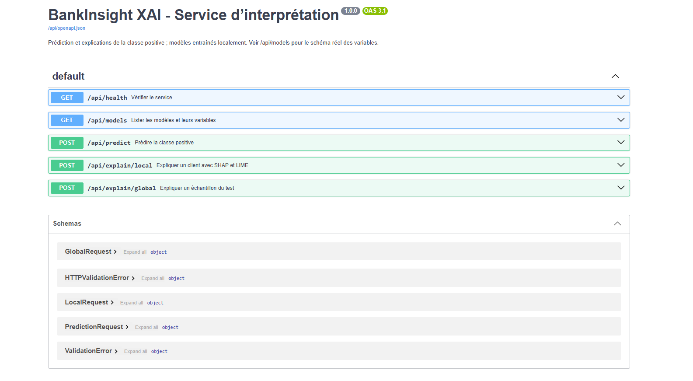

<details>
<summary>Intégration du service dans Streamlit</summary>

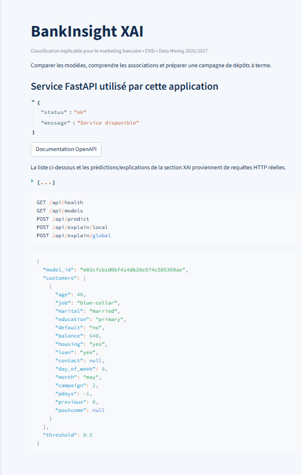

</details>

## Architecture et méthodologie

```text
app.py -> src/api_client.py -> HTTP FastAPI -> registre local -> Pipeline scikit-learn
                  src/data.py -> préparation -> CV -> modèle retenu -> registre
```

Une seule implémentation par responsabilité : `data`, `preprocessing`, `modeling`, `evaluation`, `explainability`, `model_registry`, `plots`. Le notebook et les scripts réutilisent ces fonctions. Streamlit lit les partitions et résultats du registre pour présenter l’évaluation ; il ne possède pas de seconde logique d’inférence. Joblib ne charge que les identifiants hexadécimaux du registre local de confiance ; aucune désérialisation de fichier envoyé par l’utilisateur.

Le test stratifié est séparé en premier, puis le mode rapide réduit seulement l’entraînement à 2 500 lignes. Le mode complet conserve l’ensemble de l’entraînement. À chaque pli de CV, les imputations, l’encodeur et le scaler sont réajustés. La recommandation dépend de l’AP moyenne de CV et jamais d’une recherche sur le test. Pondération équilibrée des classes pour logistique/arbre/forêt, ratio négatifs/positifs pour XGBoost ; KNN utilise les distances. Les probabilités ne sont pas calibrées ; ne pas les traiter comme des taux commerciaux absolus.

**Le seuil sur le test est exploratoire.** Il modifie décisions, matrice, précision, rappel et F1, mais ni ROC-AUC ni AP. Aucun seuil optimal n’est revendiqué. Faux positif : appel sans souscription ; faux négatif : occasion manquée. Un seuil opérationnel devrait être choisi sur des prédictions de validation issues exclusivement de l’entraînement, à partir de coûts métier.

SHAP explique une fonction scalaire `P(classe positive)` commune aux cinq modèles via l’algorithme permutation : pas de sélection ambiguë d’un axe de classes. Il masque des **variables métier entières**, puis redécode les catégories avant le Pipeline : pas de combinaisons one-hot impossibles à l’intérieur d’une variable. Références : 20 clients d’entraînement, 3 permutations, 24 observations globales par défaut (8 à 48 dans l’UI, maximum 50 dans l’API). Contrôle d’additivité en probabilité à 1e-5. Les dépendances entre variables ne sont pas préservées par ce masquage marginal ; les références et l’échantillonnage influencent les attributions. Les codes catégoriels des graphiques sont accompagnés de leur dictionnaire.

LIME explique le même client, modèle et classe 1, avec 700 perturbations, catégories discrètes et variables continues discrétisées. Ses poids concernent un substitut local ; sa fidélité R² et l’accord de signe sur les trois principaux facteurs SHAP sont affichés. Ces méthodes ne prouvent aucune causalité. Les importances natives agrègent les valeurs absolues selon une correspondance positionnelle exacte des colonnes encodées ; le tableau détaillé conserve les coefficients signés. L’importance par permutation utilise 300 clients fixes du test au maximum, 3 répétitions et la baisse d’AP ; son rôle est descriptif, pas la sélection après consultation du test.

## Reproduire les résultats et le notebook

```powershell
.\.venv\Scripts\python.exe scripts/run_experiment.py --full --budget 2
.\.venv\Scripts\python.exe scripts/audit_release.py
.\.venv\Scripts\python.exe scripts/generate_report.py
```

Le script entraîne les cinq modèles, enregistre les artefacts publics approuvés et `reports/experiment.json`, puis calcule les preuves SHAP/LIME. Le rapport lit uniquement ces preuves. La recette finale utilise **36 168 lignes d’entraînement et le holdout inchangé de 9 043 lignes**, graine 42, deux candidats par modèle et trois plis. Le budget était fixé avant cette exécution ; aucun réajustement n’a été effectué selon les résultats du test.

| Modèle | AP CV rapide | AP CV complet | AP test rapide | AP test complet | ROC-AUC test complet |
|---|---:|---:|---:|---:|---:|
| Logistique | 0,312 | 0,384 | 0,381 | 0,394 | 0,752 |
| Arbre | 0,259 | 0,364 | 0,309 | 0,375 | 0,745 |
| KNN | 0,230 | 0,297 | 0,244 | 0,321 | 0,694 |
| Forêt | 0,348 | 0,400 | 0,398 | 0,410 | 0,765 |
| XGBoost | 0,331 | **0,427** | 0,371 | **0,446** | **0,787** |

Le mode complet retient XGBoost par AP CV. Il a pris **83,14 secondes**, explications incluses, avec un pic RSS mesuré de **476,93 Mio**, sous limites de 900 secondes, 1 536 Mio et deux threads de calcul. Mesures : `reports/full_training_resources.json`. Les résultats rapides conservés dans `reports/quick_experiment.json` et la comparaison `reports/mode_comparison.json` sont historiques, non des implémentations concurrentes.

**Le holdout avait déjà été consulté lors de la démonstration rapide** : la comparaison est descriptive, pas une nouvelle validation indépendante ni un test de significativité. Les empreintes du dataset et des indices train/test figurent dans la provenance de l’expérience. La fidélité LIME du client final reste faible (**R² 0,294**), même si les principaux signes concordent avec SHAP ; ses poids appellent donc à la prudence. Le mois, le logement à crédit et l’issue de la campagne précédente dominent l’échantillon SHAP final ; il ne s’agit pas d’effets causaux.

Ouvrir `notebooks/01_bank_marketing_analysis.ipynb` dans Jupyter ou VS Code, sélectionner Python du venv et exécuter dans l’ordre. Pour vérifier sans interface :

```powershell
.\.venv\Scripts\python.exe scripts/execute_notebook.py
```

## Utiliser l’API

`GET /api/models` fournit les identifiants réels et la liste exacte des caractéristiques attendues. Un client doit contenir toutes ces clés, avec `null` pour une valeur manquante. Une catégorie inconnue est acceptée et encodée comme inconnue ; une colonne en trop ou absente est refusée (422), un modèle inconnu renvoie 404. Les explications sont limitées en taille ; la démonstration n’inclut pas de service d’authentification ni de limitation de débit pour un usage bancaire de production.

Exemple PowerShell sur le modèle public livré, sans recopier manuellement 15 attributs :

```powershell
$proof = Get-Content reports/experiment.json -Raw -Encoding utf8 | ConvertFrom-Json
$body = @{model_id=$proof.selected_id; customers=@($proof.customer); threshold=0.5} | ConvertTo-Json -Depth 8
Invoke-RestMethod -Uri http://127.0.0.1:8000/api/predict -Method Post -ContentType application/json -Body $body
```

Pour une explication locale : corps `{ "model_id": "identifiant réel", "customer": { "toutes les variables": "valeurs" }, "threshold": 0.5 }` vers `/api/explain/local`. Pour le global : `{ "model_id": "identifiant réel", "sample_size": 24 }` vers `/api/explain/global`. Les exemples de `/api/docs` sont structurels ; remplacer l’identifiant et compléter selon le modèle effectivement sélectionné.

## Tests et livraison

```powershell
.\.venv\Scripts\python.exe -m pytest -q
.\.venv\Scripts\python.exe scripts/package_submission.py
.\.venv\Scripts\python.exe scripts/verify_submission.py
```

Tests synthétiques : classes/cible, cache et téléchargement simulé, CSV, exclusion de duration, split, transformations apprises sur l’entraînement, cinq modèles, recherche limitée au train, seuil/métriques, registre, SHAP positif/additivité, LIME et API. Tests de livraison : PDF exactement une page et ZIP extrait, sans chemins externes. `scripts/run_experiment.py` constitue le test réel UCI. Voir `reports/verification.json` pour les commandes effectivement exécutées et leurs limites.

Avec l’API locale en marche :

```powershell
$env:BANKINSIGHT_API_URL='http://127.0.0.1:8000'
.\.venv\Scripts\python.exe scripts/verify_ui.py
```

La génération du ZIP utilise une liste blanche et une liste de modèles UCI publics, exclut venv, Git, caches Python, fichiers secrets et CSV privés. Le script vérifie CRC, livrables essentiels et extraction temporaire. Le fichier livré est `Challenge1_Classification_Explicable_ENSI.zip` à la racine. Après extraction, refaire installation et `pytest`, puis lancer `scripts/run_local.py`. Aucun chemin du poste de développement n’est requis.

`.gitattributes` préserve les octets des CSV, PDF et modèles : la conversion automatique des fins de ligne Windows ne doit ni invalider le SHA256 du cache UCI ni modifier les offsets internes du PDF. L’index Git de recette a été comparé octet pour octet à ces fichiers.

Pour la publication sur GitHub ou Hugging Face, produire **l’archive distincte sans le PDF pédagogique** :

```powershell
.\.venv\Scripts\python.exe scripts/package_submission.py --public
.\.venv\Scripts\python.exe scripts/verify_submission.py --archive BankInsight-XAI_publication.zip
Expand-Archive -LiteralPath BankInsight-XAI_publication.zip -DestinationPath tmp/publication
```

Publier uniquement le contenu de `tmp/publication/BankInsight-XAI`. L’archive destinée au professeur contient son cahier des charges ; elle ne doit pas être téléversée telle quelle sur un dépôt public. Les anciens modèles locaux hors liste approuvée ne sont inclus dans aucune des deux archives.

## Déploiement gratuit sur Streamlit Community Cloud

Le point d’entrée dédié est **`cloud_app.py`**. Il démarre la FastAPI canonique sur **127.0.0.1:8765**, attend sa santé, puis exécute **`app.py`**. Les prédictions et interprétations passent toujours par de vraies requêtes HTTP. L’interface et le service partagent les mêmes fichiers du registre ; aucune copie de la logique ML ni aucun service externe ne sont nécessaires.

Dans [Streamlit Community Cloud](https://share.streamlit.io/), choisir **Create app**, puis renseigner :

| Paramètre | Valeur |
|---|---|
| Repository | `AhmedZri/BankInsight-XAI` |
| Branch | `main` |
| Main file path | `cloud_app.py` |
| Python version, dans Advanced settings | **3.11** |
| Secrets | Aucun requis |
| Dépendances Python | `requirements.txt`, détecté automatiquement |
| Dépendances système supplémentaires | Aucune : pas de `packages.txt` |

Choisir le sous-domaine souhaité s’il est disponible, puis **Deploy**. La connexion à Community Cloud et l’autorisation d’accès au dépôt doivent être effectuées dans le compte du propriétaire. Le dépôt est déjà public. Aucun abonnement payant ni aucune VM ne sont nécessaires. [Procédure officielle](https://docs.streamlit.io/deploy/streamlit-community-cloud/deploy-your-app/deploy).

### Démarrage partagé et documentation API

`st.cache_resource` conserve un gestionnaire partagé entre les sessions. Un verrou noyau interprocessus protège le démarrage et un identifiant vérifie que le port appartient à notre service. Les reruns et sessions simultanées réutilisent donc la même API ; si elle s’arrête, elle est redémarrée lors de la prochaine interaction. La fermeture du parent ferme son canal de supervision et arrête l’API, même si le parent s’arrête brutalement. Un client ayant seulement réutilisé le service ne peut pas arrêter celui de son propriétaire.

Un seul calcul POST d’inférence ou d’explication est traité à la fois côté API, afin d’éviter des chargements concurrents de modèles. Les endpoints de santé, liste et documentation restent accessibles en interne. Aucun cache supplémentaire des cinq modèles n’est créé.

Sur Community Cloud, **FastAPI n’est pas exposée publiquement**. La section **6 · Service API** affiche sa santé et propose **Télécharger la spécification OpenAPI**, obtenue par HTTP depuis `/api/openapi.json`. Elle permet aussi de consulter le schéma dans la page ; aucun lien localhost n’est présenté comme une URL distante. `/api/docs` reste disponible sur le serveur interne. Les chemins local et Docker conservent leur documentation Swagger habituelle.

### Vérification locale du point d’entrée cloud

```powershell
.\.venv\Scripts\python.exe -m streamlit run cloud_app.py
# Recette des six sections, HTTP, XGBoost archivé, SHAP/LIME et deuxième session :
.\.venv\Scripts\python.exe scripts/validate_cloud.py
.\.venv\Scripts\python.exe -m pytest -q
```

Le script de recette n’entraîne pas les modèles UCI et vérifie les empreintes des fichiers scientifiques avant/après. Les tests de régression habituels utilisent leurs fixtures synthétiques. La recette a réussi sur Windows et sur Linux avec un conteneur limité à **1 Gio de RAM et deux CPU**, sans dépassement mémoire. La réutilisation, le redémarrage et le démarrage simultané de l’API sont testés avec de vrais processus. Ces contrôles locaux sont complétés par la recette distante ci-dessous.

La roue Linux XGBoost embarque sa bibliothèque OpenMP ; aucun nginx ni paquet système supplémentaire n’est utilisé par le point d’entrée cloud. Python 3.11 et les versions de dépendances déjà testées sont conservés.

### Limites gratuites et validation après publication

Les [ressources Community Cloud](https://docs.streamlit.io/deploy/streamlit-community-cloud/manage-your-app) sont partagées et peuvent varier ; un test local sous plafond ne garantit pas le quota effectivement attribué au compte. Commencer la démonstration avec l’expérience complète **archivée**, sans réentraîner, et éviter plusieurs calculs lourds simultanés. Les données UCI et les cinq artefacts approuvés sont présents dans GitHub. Les fichiers créés à l’exécution sont temporaires ; réserver les CSV personnels à une exécution locale.

Après déploiement, ouvrir l’URL réellement attribuée, parcourir les six sections, expliquer un client avec le modèle XGBoost archivé et télécharger OpenAPI. La santé, la prédiction, SHAP et LIME doivent réussir via les appels HTTP internes. En cas de limite de ressources, consulter les journaux et signaler le blocage ; aucune offre payante n’est proposée. Une augmentation gratuite à titre pédagogique peut être sollicitée auprès de Streamlit, sans garantie d’acceptation.

**État de publication : [application Community Cloud opérationnelle](https://bankinsight-xai.streamlit.app/), recette distante réussie le 29 octobre 2026.** Le code Docker existant reste utilisable pour les vérifications locales, sans changement de configuration :

```powershell
docker build -t bankinsight-xai tmp/publication/BankInsight-XAI
docker run --rm --name bankinsight-demo --cpus 2 --memory 2g -p 7860:7860 bankinsight-xai
.\.venv\Scripts\python.exe scripts/verify_http.py
```

## Publication GitHub

Le dépôt public cible est **[AhmedZri/BankInsight-XAI](https://github.com/AhmedZri/BankInsight-XAI)**. Son propriétaire et les droits d’administration de GitHub CLI ont été vérifiés sur le compte **AhmedZri**, indépendamment du compte utilisé par le connecteur GitHub. Aucun jeton n’est stocké dans le projet. Le PDF pédagogique, les archives ZIP, les environnements et les artefacts non approuvés sont exclus de la publication.

Pour une nouvelle copie des seules sources publiques :

```powershell
git clone https://github.com/AhmedZri/BankInsight-XAI.git
Set-Location BankInsight-XAI
```

## Limites et captures

Données anciennes d’une banque portugaise, absence de validation temporelle prospective et d’identifiant client pour un split par client, pondération sans calibration, petit budget de recherche, explanations marginales échantillonnées. Les différences de rappel par âge/situation familiale sont exploratoires, avec effectifs affichés, sans preuve de discrimination ni d’équité. La suppression de variables sensibles ne supprimerait pas nécessairement leurs proxys.

Les exports `assets/figures/shap_global.png` et `assets/figures/shap_local.png` sont des figures calculées. Les captures fournies ensuite par le propriétaire sont présentées dans la galerie ci-dessus et incluses dans le ZIP professeur. Les rapports de recette existants conservent l’état de la vérification automatisée antérieure à cet ajout.

Lors de la recette automatisée antérieure, les outils de navigation étaient indisponibles. Le 29 octobre 2026, une session Chrome de test a permis de vérifier le vrai site public, y compris son iframe Streamlit. Les 15 captures existantes sont conservées à l’identique ; les rapports scientifiques antérieurs restent gelés. Le [parcours manuel](docs/recette_navigateur.md) conserve la procédure historique de contrôle complémentaire.

La recette Docker locale issue de l’archive publique est contrôlée avec deux CPU et 2 Gio de RAM : santé, OpenAPI, inférence, SHAP/LIME, WebSocket, pytest et parcours AppTest incluant entraînement réel et formulaire fictif. Les résultats finaux figurent dans `reports/verification.json`. Pic mémoire cgroup mesuré : **1 592 082 432 octets (1,48 Gio)** ; ce n’est pas un benchmark multiutilisateur. L’arrêt volontaire du processus API termine le conteneur et ses autres services ; le code 241 enregistré correspond à ce signal de test, sans OOM. Voir `reports/deployment_verification.json`. Aucun de ces contrôles locaux n’est présenté comme un déploiement public ou une recette navigateur.

## Recette publique du 29 octobre 2026

URL contrôlée : **https://bankinsight-xai.streamlit.app/**. Vérification dans Chrome sur le site distant, avec l’expérience archivée `8b2b7391` et le modèle XGBoost `e02cfcb1d0bf414db38e574c585369ae`, sans entraînement.

| Module | Contrôle distant réussi |
|---|---|
| 1 · Données | 45 211 observations UCI, statistiques et graphiques exploratoires affichés |
| 2 · Préparation | Configuration appliquée : 2 500 lignes d’entraînement / 9 043 de test ; aucun modèle entraîné |
| 3 · Modélisation | Commandes disponibles et comparaison des cinq modèles archivés affichée |
| 4 · Évaluation | AP 0,446, ROC-AUC 0,787, courbes ROC/PR, matrice ; curseur passé de 0,50 à 0,51 |
| 5 · Explainable AI | SHAP global sur 24 clients, dépendance et permutation ; client test 0 : 18,9 %, waterfall SHAP, table LIME et synthèse ; R² LIME 0,294, erreur d’additivité SHAP affichée : 0 |
| 6 · Service API | Réponse de santé FastAPI `status=ok`, liste et exemple du modèle, téléchargement OpenAPI réussi |

La spécification téléchargée `bankinsight_openapi.json` contient les cinq endpoints réels : santé, modèles, prédiction, explication locale et globale. Les résultats de prédiction et d’explication ci-dessus sont obtenus par les appels HTTP internes de l’interface canonique. Aucun lien localhost n’est affiché dans la section API. Aucune erreur applicative n’a été constatée pendant ce parcours. Le simple HTTP 200 de la page d’accueil Community Cloud n’a pas été utilisé comme preuve de ces calculs.

**Remise académique prête : OUI.** Les sources, notebook, FastAPI, tests, one-pager d’une page, 15 captures et documentation sont inclus dans le ZIP professeur vérifié. Les modèles, données, métriques, conclusions et captures sont inchangés. Cette recette atteste le fonctionnement observé, sans garantie de disponibilité permanente du service gratuit ni validation de charge multiutilisateur.
